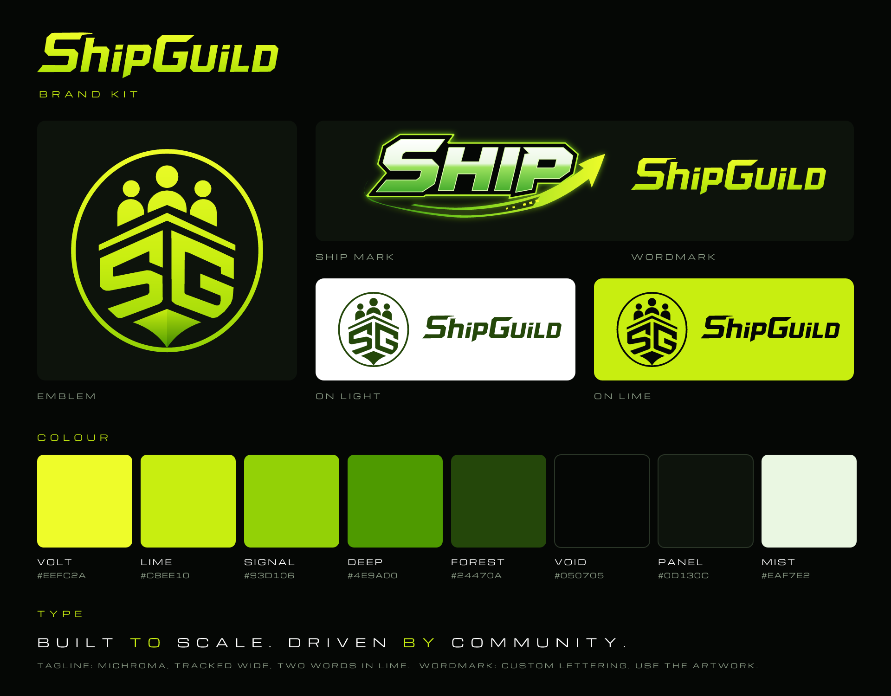

# ShipGuild Assets

Graphic assets for the ShipGuild brand.

https://www.theshipguild.com/



## What is here

| Folder | Contents |
| --- | --- |
| `svg/emblem/` | SG crew emblem: color, white, black, lime, forest. App icon and favicon sources. |
| `svg/ship/` | SHIP mark: `glow` (full effect), `flat` (no blur), white, black, lime. |
| `svg/wordmark/` | ShipGuild wordmark: color, white, black, forest. |
| `svg/lockup/` | Emblem + wordmark + tagline, horizontal and stacked, dark and light. |
| `svg/banner/` | Site banner 1950x806, X header 1500x500, LinkedIn 1584x396, Open Graph 1200x630. |
| `png/` | PNG renders of every SVG at 1x and 2x (logos up to 4096 px), transparent where the SVG is. |
| `png/favicon/` | `favicon.ico` (16/32/48), `favicon-16/32/48/192/512.png`, `apple-touch-icon.png`. |
| `brand-sheet.svg` / `.png` | One-page overview of logos, palette and type. |
| `BRAND.md` | Usage rules: colors, clear space, minimum sizes, do and don't. |
| `source/` | Build script and source geometry. Run `python source/build.py` to regenerate everything. |
| `ShipGuildLogo.png`, `SHIPlogo.png`, `ShipGuildBanner.png` | The original raster artwork, kept unchanged. |

Use the SVG files wherever the tool accepts them. Every SVG is pure vector: text is outlined, no embedded bitmaps, no font dependencies.

## Quick picks

- Website header on dark: `svg/lockup/shipguild-lockup-horizontal-dark.svg`
- Website header on white: `svg/lockup/shipguild-lockup-horizontal-light.svg`
- Avatar or profile picture: `png/emblem/shipguild-app-icon-1024.png`
- Discord / X / Telegram banner: `png/banner/shipguild-x-header-1500x500.png`
- Link previews: `png/banner/shipguild-og-1200x630.png`
- Merch, print, laser cut: `svg/emblem/shipguild-emblem-black.svg` or `-white.svg`

Favicon tags:

```html
<link rel="icon" href="/favicon.ico" sizes="48x48">
<link rel="icon" href="/shipguild-favicon.svg" type="image/svg+xml">
<link rel="apple-touch-icon" href="/apple-touch-icon.png">
```

## Rebuilding

```bash
pip install fonttools resvg-py shapely pillow
python source/build.py
```

Colors, geometry and layouts all live in `source/build.py`. Edit there and rebuild instead of editing the generated SVGs by hand.
